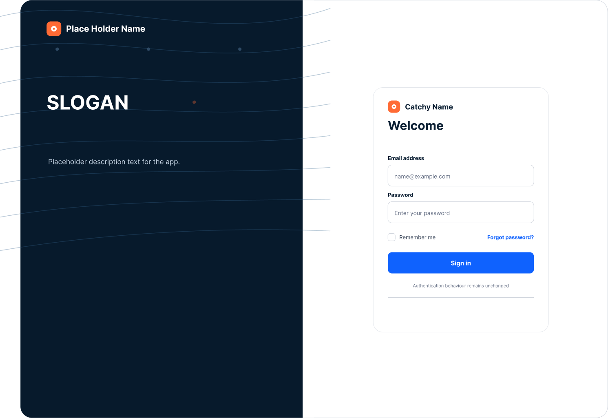
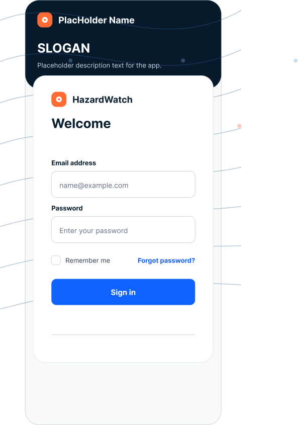
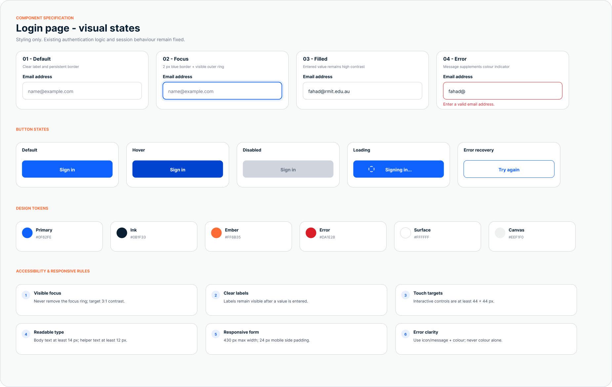
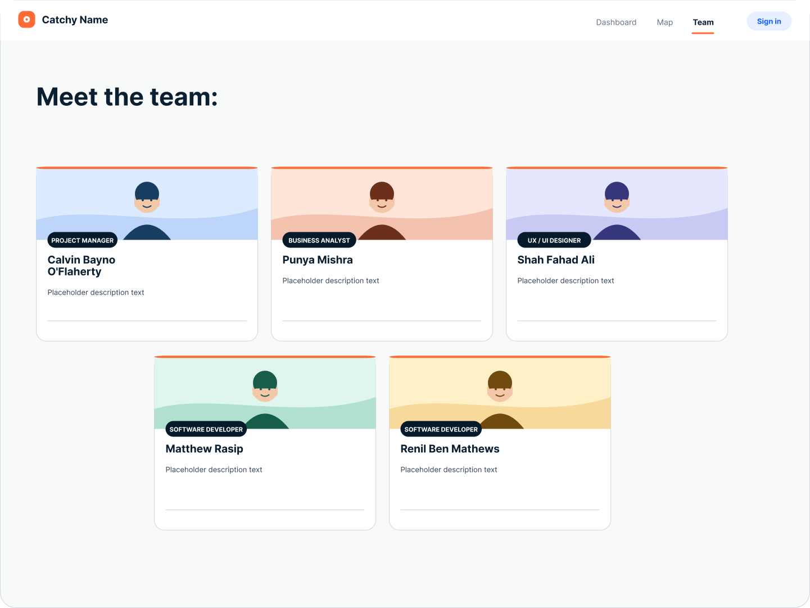
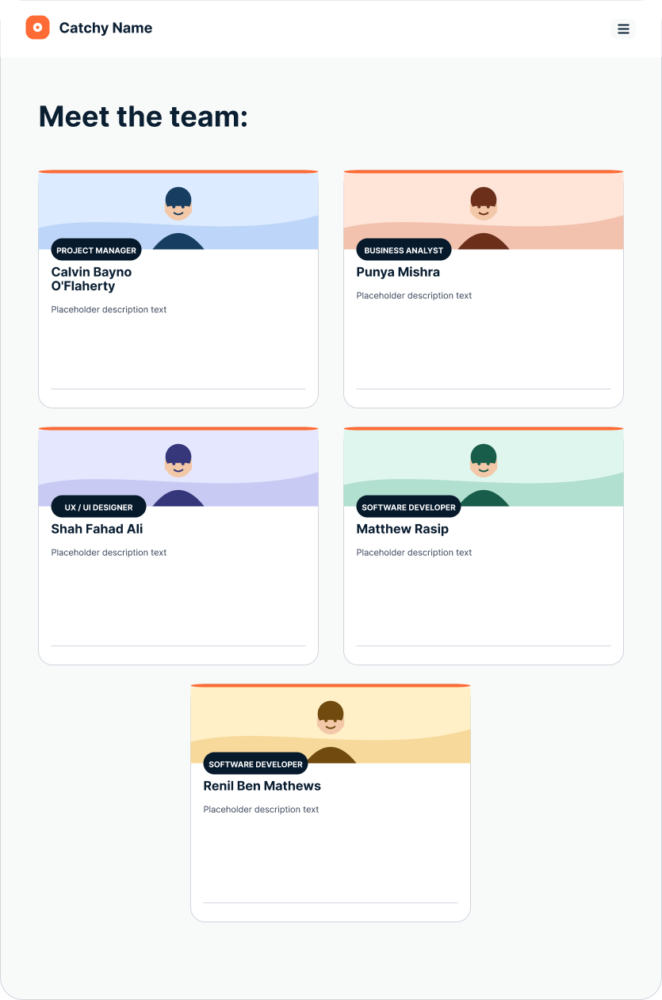
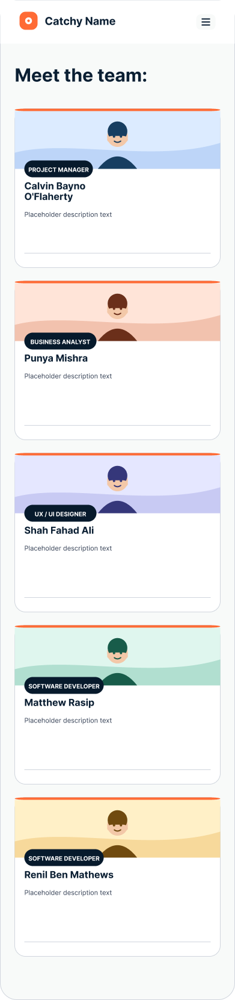
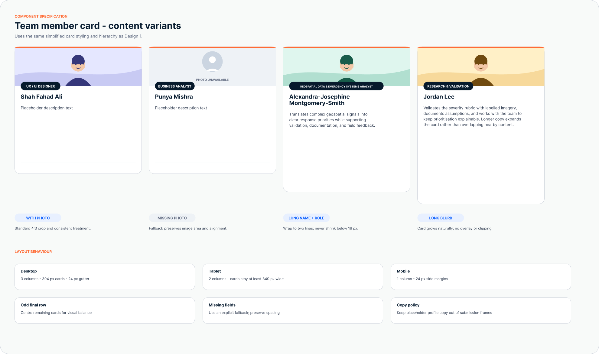

# Login and Team Page UX/UI Designs

This document contains the responsive login and team page designs, together with the component-state references required for implementation.

## Responsive views

| Page | Desktop | Tablet | Mobile |
| --- | --- | --- | --- |
| Login | Included | Uses the responsive layout between breakpoints | Included |
| Team | Included | Included | Included |

## Login page

### Desktop

### Mobile

### Form and button states

The specification covers default, focus, filled, error, hover, disabled, loading, and error-recovery states. It also records the design tokens and accessibility rules used by the login form.

## Team page

### Desktop

### Tablet

### Mobile

### Team member card states

The card specification covers standard cards, missing photos, long names and roles, long descriptions, responsive column behaviour, incomplete fields, and copy handling.

## Implementation notes

- Desktop, tablet, and mobile layouts preserve the same visual hierarchy and content order.
- Team cards change from three columns on desktop to two columns on tablet and one column on mobile.
- Form labels remain visible after a value is entered, and keyboard focus must remain clearly visible.
- Interactive controls should have a minimum touch target of 44 x 44 px.
- Placeholder brand names, slogans, descriptions, and profile copy should be replaced when final content is approved.
- Existing authentication logic and session behaviour are outside the scope of these visual updates.
